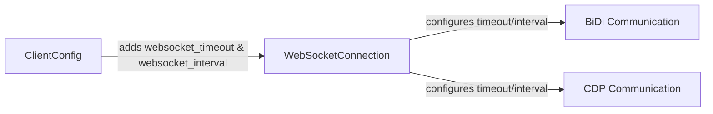

# Code Review Task

You are a maintainer reviewing a pull request to the `SeleniumHQ/selenium` repository.

**PR title:** [py] Configure WebSocket timeout and wait interval via ClientConfig

**PR description:**

### **User description**

### 🔗 Related Issues

#16270 

### 💥 What does this PR do?

This PR allows the values for WebSocket timeout and wait interval to be set via the `ClientConfig` class in the `selenium.webdriver.remote.client_config` module.

The class initializer is also where the default values are stored. Previously the values were set in private attributes in the `WebSocketConnection` class and not easily configurable by the user.

These settings are used for browser communication via WebSockets for both BiDi and CDP.

#### example usage:

setting the WebSocket timeout and wait interval on an existing local WebDriver:

```
from selenium import webdriver

driver = webdriver.Chrome()
driver.command_executor.client_config.websocket_timeout = 10
driver.command_executor.client_config.websocket_interval = 0.2
```

starting a remote WebDriver using a custom `ClientConfig` that sets the WebSocket timeout and wait interval:

```
from selenium import webdriver
from selenium.webdriver.remote.client_config import ClientConfig

client_config = ClientConfig(
    remote_server_addr="http://localhost:4444",
    websocket_timeout=10,
    websocket_interval=0.2,
)
options = webdriver.ChromeOptions()
driver = webdriver.Remote(options=options, client_config=client_config)
```

### 🔗 Related Issues
<!-- Example: Fixes #1234 or Closes #5678 -->
Fixes #16260


### 🔧 Implementation Notes

This follows the implementation discussed in the 08/21/2025 Selenium TLC call.

### 🔄 Types of changes
- New feature (non-breaking change which adds functionality *and tests!*)


___

### **PR Type**
Enhancement


___

### **Description**
- Add WebSocket timeout and interval configuration to `ClientConfig`

- Update `WebSocketConnection` to accept configurable timeout/interval parameters

- Enable WebSocket settings for both BiDi and CDP communication

- Minor documentation formatting improvements


___

### Diagram Walkthrough





<details> <summary><h3> File Walkthrough</h3></summary>

<table><thead><tr><th></th><th align="left">Relevant files</th></tr></thead><tbody><tr><td><strong>Enhancement</strong></td><td><table>
<tr>
  <td>
    <details>
      <summary><strong>client_config.py</strong><dd><code>Add WebSocket configuration properties</code>&nbsp; &nbsp; &nbsp; &nbsp; &nbsp; &nbsp; &nbsp; &nbsp; &nbsp; &nbsp; &nbsp; &nbsp; &nbsp; &nbsp; &nbsp; &nbsp; &nbsp; &nbsp; &nbsp; </dd></summary>
<hr>

py/selenium/webdriver/remote/client_config.py

<ul><li>Add <code>websocket_timeout</code> and <code>websocket_interval</code> properties with <br>descriptors<br> <li> Update constructor to accept WebSocket configuration parameters with <br>defaults<br> <li> Minor documentation formatting improvements for existing properties</ul>


</details>


  </td>
  <td><a href="https://github.com/SeleniumHQ/selenium/pull/16248/files#diff-421b55d14e80d4473c60003a3f53c9fa819375d52cb45b6c40403f481a9b8925">+12/-7</a>&nbsp; &nbsp; </td>

</tr>

<tr>
  <td>
    <details>
      <summary><strong>webdriver.py</strong><dd><code>Pass WebSocket config to connections</code>&nbsp; &nbsp; &nbsp; &nbsp; &nbsp; &nbsp; &nbsp; &nbsp; &nbsp; &nbsp; &nbsp; &nbsp; &nbsp; &nbsp; &nbsp; &nbsp; &nbsp; &nbsp; &nbsp; &nbsp; &nbsp; </dd></summary>
<hr>

py/selenium/webdriver/remote/webdriver.py

<ul><li>Update <code>start_devtools()</code> to pass WebSocket config from <code>client_config</code><br> <li> Update <code>_start_bidi()</code> to pass WebSocket config from <code>client_config</code><br> <li> Add blank line formatting improvement</ul>


</details>


  </td>
  <td><a href="https://github.com/SeleniumHQ/selenium/pull/16248/files#diff-c87c150ed2a08f5293db58a06da8bf7f14c3a5582586c6270c1be661dfdd0985">+7/-2</a>&nbsp; &nbsp; &nbsp; </td>

</tr>

<tr>
  <td>
    <details>
      <summary><strong>websocket_connection.py</strong><dd><code>Accept configurable timeout and interval</code>&nbsp; &nbsp; &nbsp; &nbsp; &nbsp; &nbsp; &nbsp; &nbsp; &nbsp; &nbsp; &nbsp; &nbsp; &nbsp; &nbsp; &nbsp; &nbsp; &nbsp; </dd></summary>
<hr>

py/selenium/webdriver/remote/websocket_connection.py

<ul><li>Remove hardcoded timeout/interval class attributes<br> <li> Update constructor to accept timeout and interval parameters<br> <li> Use instance attributes instead of class attributes for timing<br> <li> Add blank line formatting improvement</ul>


</details>


  </td>
  <td><a href="https://github.com/SeleniumHQ/selenium/pull/16248/files#diff-7db8ccff1907ae8f1040877b71b60dc4a77bd10ad6838e2eca856d2faf8d4794">+7/-7</a>&nbsp; &nbsp; &nbsp; </td>

</tr>
</table></td></tr></tr></tbody></table>

</details>

___

## Working environment

The repository is checked out at `/app/selenium` at this PR's **base commit**
(the state before this PR), and the proposed change is present two ways:

- applied as **uncommitted modifications** to the working tree (run `git diff`
  to see it, or use a review tool that inspects the local git diff), and
- saved as a unified diff at `/app/pr_to_review.diff`.

Use `git log` and `git show HEAD:<path>` (HEAD is the base commit) for
surrounding history, call sites, and conventions.

## Your task

Perform a thorough, critical code review of this pull request. Look for bugs,
correctness issues, regressions, security problems, broken edge cases, and
anything else a maintainer should require changed before merging.

For every issue you find: name the file and specific lines, explain what is
wrong and why, and suggest a concrete fix. Rank the issues by severity.
If the PR looks correct, say so.

Write your review to `/app/review.md`.
